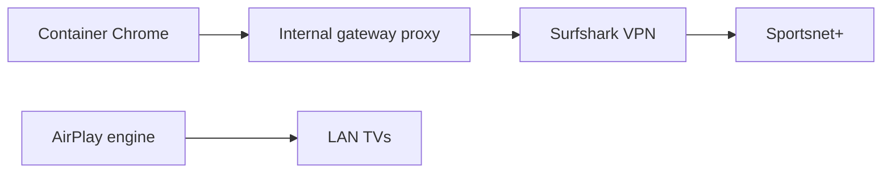

# Sportsnet+ through a private VPN gateway

AirplayVideo can open Sportsnet+ as a saved browser page. Its optional browser
VPN control selects a separate Surfshark gateway, while AirPlay discovery and
delivery continue over the LAN. The control uses the saved gateway when **On**
and ordinary direct browser networking when **Off**.

## Configure the gateway

1. Install **Surfshark Gateway** from this app repository. Keep Protection mode
   enabled. It has its own network namespace, `NET_ADMIN`, and a TUN device;
   it does not use host networking or publish a proxy port on the LAN.
2. Enter the existing Surfshark **manual OpenVPN service credentials**, or a
   manually provisioned WireGuard key/address, in the gateway's private app
   configuration. These differ from the account email/password. Keep them out
   of saved pages, proxy URLs, chat, reports, and Git. See the gateway's own docs.
3. Choose the intended Canadian city and start the gateway. A started app is
   not by itself evidence that its VPN connection is ready.
4. In AirplayVideo, stop its own playback, then open **Settings → Source defaults**.
   Set **VPN gateway** to `http://GATEWAY_INTERNAL_HOSTNAME:8888`, choose a
   **VPN control name** such as `Montréal VPN`, and save. The name identifies
   the control; it does not select or verify the gateway's city. For a
   repository app, Supervisor normally replaces underscores in the app ID with
   hyphens for internal DNS; a local install has a different prefix. Use this
   installation's actual hostname, rather than a changing container IP.
5. Disable browser VPN extensions in this Chrome profile. An extension can
   override Chrome's proxy settings; do not combine the Surfshark extension with
   this gateway. The retained profile keeps existing browser sign-ins.
6. Open the browser and check its public country plus DNS/WebRTC results before
   starting Sportsnet. If the gateway is unavailable, fix it before browsing;
   do not add a direct fallback.

Use the named switch in Playback or Home Assistant to turn the browser VPN
**On** or **Off**. Off preserves the saved gateway address for the next On.
An upgrade from the original proxy-only setting preserves its enabled route.
Changing the route requires idle playback, recordings and measurements; it
closes Chrome while preserving the normal persistent profiles and sign-ins.

The selected route applies to **every browser page** in both browser sessions,
including browser YouTube and LAN pages. Native YouTube extraction, HDHomeRun,
and the AirPlay engine do not use it. With On selected, an unreachable gateway
does not switch the browser to a direct connection. The reachability indicator
checks the gateway's TCP listener; it does not certify a Canadian exit, tunnel
health, account eligibility or playback.

## Use Sportsnet+

Save a page named **Sportsnet** for `https://watch.sportsnet.ca/`, open it through
AirplayVideo, and sign in yourself. Use Sportsnet's own fullscreen player
control; AirplayVideo's **Fullscreen video** helper is for YouTube.

Sportsnet opens in its own persistent browser session. The original browser
session, including YouTube sign-ins, stays in place. The app selects Sportsnet
for initial addresses on exactly `sportsnet.ca`, `www.sportsnet.ca`,
`watch.sportsnet.ca` and `account.sportsnet.ca`; normal sign-in redirects remain
in that session. No cookies or site data are copied or cleared. Sign in again
in the new Sportsnet session after upgrading; existing Sportsnet state in the
original session is retained. The VPN selection applies to both sessions.

Only one browser desktop runs at a time. Stop playback and finish recordings or
measurements before opening a page that switches sessions. The original private
root remains `/data/browser`; Sportsnet uses `/data/browser-sportsnet`, with its
own home, Chrome profile, display, audio and controls. Both use the existing
parent-owned companion signing key. Setup's open preview preserves an already
open sign-in instead of navigating it away.

Check each Capitals game in the [NHL Game Finder](https://support.sportsnetplus.ca/hc/en-gb/articles/46381950833556-NHL-Game-Finder).
Premium includes out-of-market hockey with regional restrictions; Wednesday
Night Hockey is on Prime Video in the [2026/27 season](https://support.sportsnetplus.ca/hc/en-gb/articles/53444277671828-Where-to-Watch-NHL-Hockey-In-2026-2027).
Sportsnet [requires physical presence in Canada and does not support VPN access
from outside Canada](https://support.sportsnetplus.ca/hc/en-gb/articles/46382041630228-Can-I-access-Sportsnet-internationally).
A Canadian exit, successful sign-in, or rendered schedule does not establish
that the account can play a protected game in this Linux browser.

Prepare the player before selecting an idle TV. A new source replaces the
shared source on active AirplayVideo receivers. Do not interrupt another app's
streaming session to test this setup. Receiver connection/counters, visible
capture, physical picture, and audible sound are separate verification stages.

For the Capitals-specific check and the existing Home Assistant game-start
automation, see [Live Capitals events](capitals-live-events.md). That action
enables the saved VPN route and can replace AirplayVideo playback on the
explicitly selected TVs when one fresh live broadcast is found. It does not
grant Sportsnet access or establish physical output.

## Connection and verification boundaries

While the VPN control is On, Chrome gets one fixed proxy, no direct fallback,
proxy-side destination DNS,
QUIC disabled, and non-proxied WebRTC UDP disabled. Its implicit loopback bypass
is removed. The gateway retains Gluetun's firewall. These controls are intended
to prevent ordinary browser requests from escaping the selected route; their
configuration is not a blanket claim of verified protection under every failure.

The bounded browser fixture uses empty profiles and no accounts or TVs. Check
gateway startup/failure/restart and the real browser's IP, DNS, and WebRTC
behavior on the installed system before claiming live fail-closed behavior.
Do not change host routes or firewall rules to simulate a failure.

The initial extension trial failed account sign-in. The retained original
profile also failed after moving to the gateway; Mac identity and popup
changes alone did not resolve it. On 2026-10-25, an isolated normal persistent
Sportsnet profile on Linux Chrome signed in through the Montreal gateway and
displayed Sportsnet East video. Incognito had also reached the password step.
That makes profile-specific site/device state a useful explanation to
investigate; no particular cookie or provider rule was proved. Real-account
persistence after restarting Chrome, physical TV picture/sound, and the new
VPN controls/game-start workflow remain separate acceptance checks.

Never capture credentials or raw browser/profile data for troubleshooting.

References: [Surfshark manual OpenVPN](https://support.surfshark.com/hc/en-us/articles/360011051133-How-to-set-up-manual-OpenVPN-connection-using-Linux-Terminal),
[Chromium proxy behavior](https://chromium.googlesource.com/chromium/src/+/HEAD/net/docs/proxy.md),
[HA internal app communication](https://contributors.home-assistant.io/apps/guides/communication/).
